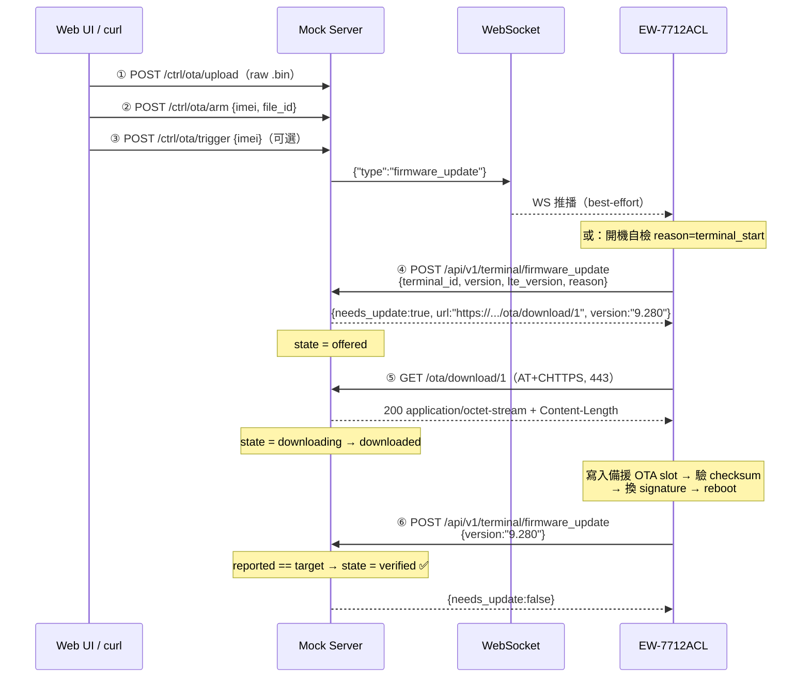

# EW-7712ACL ↔ Mock Server：OTA 協定與機制全紀錄

本文件描述 **裝置（EW-7712ACL / Ameba-D + SIM7500）** 與 **mock cloud server**（模擬 `sv.jihan-pi.jp` / `ws.jihan-pi.jp`）之間，OTA 相關的**所有協定層、封包格式、狀態機與時序**。

- 韌體端依據：`$AMEBA_XIP/LTE_task/gplus_fota.c`、`gplus_at_pay.c`、`gplus_websocket.c`、`LTE_task.c`
- Server 端依據：`routes/ota.js`、`routes/ota-admin.js`、`routes/ota-download.js`、`ws/handler.js`、`db/index.js`

---

## 0. 一張圖看完



---

## 1. 參與的四條通道

| # | 通道 | 協定 | 方向 | 用途 |
|---|------|------|------|------|
| A | WebSocket | `wss://` (SIM7500 內建 WS) | Server → 裝置 | 推 `firmware_update` 觸發訊息 |
| B | HTTPS API | `POST /api/v1/terminal/firmware_update` | 裝置 → Server | 查詢是否需更新 / 回報目前版本 |
| C | 韌體下載（Ameba） | `GET /ota/download/:id`，走 `AT+CHTTPS`（raw socket + 自組 HTTP） | 裝置 → Server | 抓 Ameba 主韌體映像 |
| D | 韌體下載（LTE 模組） | 走 SIM7500 內建 HTTP（`AT+HTTPINIT/HTTPACTION`） | 裝置 → Server | 抓 SIM7500 delta 包 |
| E | 控制台 API | `/ctrl/ota/*` | Web UI / curl → Server | 上傳、arm、trigger、查狀態（**不經過裝置**） |

> A、B、C、D 是「裝置 ↔ server」的真實協定；E 只是測試工具的操作面。

---

## 2. 觸發路徑（誰啟動 OTA）

| 路徑 | 進入點 | `reason` 欄位 | 是否受 `boot_fota` 旁路影響 |
|------|--------|--------------|--------------------------|
| **開機自檢** | `LTE_task.c` → `_All_In_One_FOTA_process()` → `_boot_fota_one_process()` | `terminal_start` | ✅ 受影響。`SysCfg_boot_fota_get()==false` 時印 `BYPASS FOTA for Developement` 直接跳過 |
| **WS 推播** | `gplus_websocket.c` `firmware_update` handler → `is_fota_requested` → `firmware_upgrade()` | `server_request` | ❌ 不受影響（`ameba_firmware_upgrade(true /*ws_request*/)`） |

WS 路徑的兩個特殊行為（`gplus_websocket.c:1729`）：

- **現金交易中會延後**：`cash_pay_process == true` 時把該訊息標成 `SLOT_EVENT_IS_PENDING`，不立刻執行，等交易結束再處理。
- **WS 觸發會設旗標**：`SysCfg_wss_fota_set(true)`。若這次 OTA 失敗並重開機，開機自檢會看到旗標而**跳過一次** FOTA（印 `BYPASS FOTA for last WSS FOTA failure`），避免無限失敗迴圈；成功時在 reboot 前被清掉。

開機自檢的重試策略（`LTE_task.c`）：

```
MAX_NUM_OF_AMEBA_FOTA_RETRY = (24*60)/10 = 144 次
第 1 次失敗 → 立刻檢查網路 → 重試
第 2 次起   → 等 _FOTA_retry_interval（預設 10 分鐘）→ 檢查網路 → 重試
超過 144 次 → DO_SysReboot()
```
> 這就是為什麼 server **必須持續回 `needs_update:true` 直到裝置回報目標版本**——只有這樣重試才有意義。`routes/ota.js` 的 `state !== 'verified'` 條件即為此設計。

---

## 3. 通道 A：WebSocket 觸發訊息

Server → 裝置，`ws/handler.js:89 pushToTerminal()`：

```json
{ "type": "firmware_update" }
```

- 純 fire-and-forget：**沒有 ACK、沒有重送**。`POST /ctrl/ota/trigger` 回的 `ok:true` 只代表 server 的 `ws.send()` 成功。
- 裝置端是由主迴圈輪詢 SIMCom 的 WS 快取取得 frame；若當下正在開機、忙其他 AT 操作、或 WS 重連（重連會清掉 SIMCom 快取），這個 frame 就會遺失。
- 要**確定性重現**請改用 `boot_fota=1` + reboot 路徑。

裝置 → Server 的 WS 訊息（`log`、`status` 等）與 OTA 無關，不在本文件範圍。

---

## 4. 通道 B：HTTPS 查詢 API

### 4.1 裝置送出的請求

由 `firmware_update_api()`（`gplus_fota.c:1132`）組出，走 `AT+CHTTPSSEND`。實際 wire 內容（`format_api_http_message()`，`gplus_at_pay.c:1128`）：

```http
POST https://<api_server>/api/v1/terminal/firmware_update HTTP/1.1
Host: <api_server>
Authorization: <terminal_token>        ← 只有 token 長度 >= 32 才會帶
Content-Language: en-us
Content-Type: application/json
Content-Length: <n>
Connection: Keep-Alive

{"terminal_id":"<IMEI>","version":"3.280","lte_version":"LE11B10SIM7500JC_xxxxxx","reason":"terminal_start"}
```

| 欄位 | 來源 | 說明 |
|------|------|------|
| `terminal_id` | `lte_config->terminal_id` | 即 IMEI，mock server 用它當 key |
| `version` | `EDX_FW_VERSION` | Ameba 主韌體版本（如 `3.280` / `9.280`） |
| `lte_version` | `get_lte_FW_revision()` | SIM7500 模組韌體版本 |
| `reason` | `terminal_start` \| `server_request` | 觸發來源 |

> **關於 sign / nonce**：`firmware_update_api()` 會算一組
> `sha256("nonce=<tick>&version=..&lte_version=..&reason=..&terminal_id=..")`，
> 但 `format_api_http_body()` 的 `API_OTA` 分支**並未把 sign / nonce 放進 body**，`format_api_http_message()` 也沒放進 header。
> ⇒ **實際上線的 OTA 查詢沒有簽章欄位**，mock server 因此不需要驗簽。
> 路徑常數：`gplus_at_pay.h:46 OTA_API = "/api/v1/terminal/firmware_update"`。

請求逾時：`GPLUS_API_TIMEOUT_MS = 10 秒`（`gplus_at_pay.h:54`）。

### 4.2 Server 的回應

`routes/ota.js` 一律回**固定 6 個欄位**，任何情況都不得為 `null`：

```json
{
  "version": "9.280",
  "url": "https://mock-jihan.ddns.net/ota/download/1",
  "lte_version": "",
  "lte_needs_update": false,
  "lte_url": "",
  "needs_update": true
}
```

| 欄位 | 型別 | 意義 |
|------|------|------|
| `needs_update` | bool | Ameba 主韌體要不要更新 |
| `url` | string | Ameba 映像下載網址 |
| `version` | string | 更新後應該變成的版本 |
| `lte_needs_update` | bool | SIM7500 模組要不要更新 |
| `lte_url` | string | 模組 delta 包網址 |
| `lte_version` | string | 模組更新後版本 |

> ⚠️ **絕對不能回 `null`**：韌體端註解寫得很直接（`gplus_fota.c:1262`）——
> `"version":null` 會讓 cJSON 取 `valuestring` 時 **Hard Fault 當機**。
> 韌體的防禦是：`needs_update` 為 false 時**根本不去 parse** `version`/`url`；
> 但 `needs_update` 為 true 時就一定會 parse，所以 server 這兩欄必須是字串。

### 4.3 Server 端判斷邏輯（`routes/ota.js`）

```
target = getArmedTarget(imei)            # 找不到本機 imei 就 fallback 到 '*' 廣播列
if (!target || target.state == 'verified') → 全部回 false
else:
    reported = (transport=='lte') ? body.lte_version : body.version
    if reported == target.target_version:
        state ∈ {offered, downloading, downloaded} → 'verified' ✅
        否則（還是 armed）                          → 'already_current'
    else:
        回 needs_update/url（或 lte_needs_update/lte_url），state → 'offered'
```

`IN_PROGRESS = {offered, downloading, downloaded}` 這個集合是為了區分
「**真的被我們更新成功**」與「**裝置本來就是這個版本**」。

---

## 5. 通道 C：Ameba 主韌體下載（`AT+CHTTPS`）

這是整條流程最特別的一段——**韌體不是用 SIM7500 的 HTTP client，而是自己組 HTTP 字串丟進 SSL socket**。

### 5.1 連線建立

`ameba_firmware_upgrade()`（`gplus_fota.c:1648`）：

```
parse_hostname(url, vhostname)          # 從 url 取 host
AT+CHTTPSSTART                          # GPLUS_https_start()
AT+CHTTPSOPSE="<host>",443,2            # simcom7500_chttps_open(host, 443, true)
```

> ⚠️ **port 固定 443、SSL type 固定 2**，寫死在程式碼裡。
> ⇒ mock server 的 `PUBLIC_BASE_URL` 必須是裝置連得到的 **HTTPS 443** host（本專案為 `https://mock-jihan.ddns.net`），不能給 `http://ip:3000`。

> ⚠️ **`parse_hostname()` 要求 URL 必須含 `://` 且 host 之後還要有 `/`**，否則回 -1 直接放棄。
> `https://mock-jihan.ddns.net/ota/download/1` ✅ 符合。

### 5.2 送出的 GET 請求

`format_ota_http_message()`（`gplus_fota.c:458`）：

```http
GET https://mock-jihan.ddns.net/ota/download/1 HTTP/1.1
User-Agent: Mozilla/4.0 (compatible; MSIE5.01; Windows NT)
Host: mock-jihan.ddns.net
Content-Type: text/plain
Content-Length: 0
Connection: Keep-Alive


```

特徵（mock server 必須容忍）：

- **request-target 是絕對 URL**（`GET https://host/path`，非 `GET /path`）——這是 proxy 用的 absolute-form。Node/Express 可正常解析成 `req.path`。
- 一個 **GET 卻帶 `Content-Length: 0` 與 `Content-Type`**。
- 沒有 `Authorization`、沒有 `Range`、沒有 `Accept`。⇒ 下載端點必須**公開無認證、不支援續傳**。

### 5.3 收資料：`AT+CHTTPSRECV`

`ccsimcom7500_https_ota_receive()`（`gplus_fota.c:305`）：

```
AT+CHTTPSRECV?              → "+CHTTPSRECV: LEN,<cached>"   查快取有多少
AT+CHTTPSRECV=2048          → "+CHTTPSRECV: DATA,<len>\r\n<binary...>"
```
每輪最多 2048 bytes；程式會處理「一次回應裡出現兩段 `+CHTTPSRECV: DATA,n`」的黏包情況，把 AT 標頭字串從 binary 流中剔除。
`+CHTTPSRECV: <err>` 非 0 代表錯誤，特定碼代表 **peer closed**。

### 5.4 裝置對回應的四道檢查（任一不過就中止）

| # | 檢查 | 程式位置 | 對 server 的要求 |
|---|------|---------|-----------------|
| 1 | 狀態行必須是 `HTTP/1.1 200` | `get_ota_http_response_status()` | 不可 30x 轉址、不可 206 |
| 2 | `Content-Length` 必須落在 **550000 ~ 1400000** | `FOTA_UPDATE_MIN_SIZE` / `MAX_SIZE`（`gplus_fota.c:32`） | 映像不能太小或超過 ~1.4 MB |
| 3 | `Content-Type` 必須**剛好等於** `application/octet-stream` | `is_octet_stream()` | 不能加 `; charset=...` |
| 4 | body 內必須找得到 16-byte OTA frame header | `search_bytes()` | 上傳的是真的 Ameba OTA 映像 |

OTA frame header（`gplus_fota.c:765`）：

```
FF FF FF FF 01 00 00 00  4F 54 41 31  18 00 00 00
                         "O  T  A  1"
```

Server 端 `parseOtaHeader()`（`routes/ota-admin.js:24`）就是找同一個 `OTA1` magic：
- `magic + 8` → **Checksum**（u32 LE）
- `magic + 12` → **ImgLen**（u32 LE）

有 magic → `kind='ameba'`；沒有 → 視為 `kind='lte'`（SIM7500 delta）。

### 5.5 寫 Flash

```
ota_get_cur_index()  → 目前在 slot1 就寫 slot2，反之亦然
erase_ota_target_flash(CHIMG_ADDR[0][target_idx], 1.5 MB)   # gplus_fota.c:781
```
- 寫入起點 = `slot 起址 - SPI_FLASH_BASE + 8`（**跳過 8-byte signature**）。
- 第一包要再跳過 32-byte header（`header_offset=32`）+ 8-byte signature；signature 先抄到記憶體，**最後才寫**。
- 每包寫入前做邊界檢查（`write_offset + recv_len > FOTA_UPDATE_MAX_SIZE` 即中止）。
- 寫 Flash 前後 `device_mutex_lock/unlock(RT_DEV_LOCK_FLASH)`。

結束條件：`recvlensum - https_header_len >= Content-Length`。
整段接收有 **`TIMEOUT_AMEBA_FOTA = 75 秒`** 的總逾時（`gplus_fota.c:31`）。

### 5.6 驗證與切換

`verify_fota_chksum()`（`gplus_fota.c:638`）：

```
從 flash 回讀剛寫入的 (ImgLen - 8) bytes，逐 byte 累加
再加上 8 bytes signature 的累加
== OTA1 header 裡的 Checksum ?
```

通過 → `change_fota_sign()`：
1. 把 8-byte signature 寫進**新 slot** 的起始位址（此時新映像才「生效」）
2. 把**舊 slot** signature 的前 4 bytes 清成 0（讓 bootloader 不再選它）

再回到 `fota_api()`：
```
set_system_boot_count(0)
SysCfg_wss_fota_set(false)
DO_SysReboot()
```

> **Server 完全不驗 checksum**——`routes/ota-download.js` 只負責把 bytes 原封不動送出。
> 正確性由裝置**回讀 flash** 自行驗證，這是設計上刻意的（斷電/亂碼都由裝置端擋）。
>
> 失敗時**不會 reboot**（`gplus_fota.c:1122` 註解：`CY, do NOT reboot after fota failure by request!!`）。

### 5.7 Server 的下載端點行為（`routes/ota-download.js`）

```http
HTTP/1.1 200 OK
Content-Type: application/octet-stream
Content-Length: <size>
Content-Disposition: attachment; filename="EW7712ACL_v9.280.bin"
Connection: keep-alive
```
- `fs.createReadStream().pipe(res)` 串流送出。
- `res.on('finish')` → 全部 bytes 進 socket → 狀態 `downloading|offered → downloaded`，累計下載次數／位元組。
- `res.on('close')` 且未 finish → 印 `download aborted`，發 SSE `download_aborted`（**不改 DB 狀態**，讓裝置重試時仍能被 offer）。
- 檔案不存在回 `404`；DB 有紀錄但磁碟檔沒了回 `410`。

---

## 6. 通道 D：SIM7500 模組 delta 下載（`AT+HTTP*`）

與 Ameba 完全不同的路徑（`lte_https_fota()`，`gplus_fota.c:1319`）：

```
從 lte_url 解析檔名 → simcom7500_FS_find_delete("F:/", <檔名>)
                      simcom7500_FS_find_delete("F:/", "update_ota.zip")
AT+SIMCOMATI / AT+CSUB          # 記錄現行模組版本
AT+HTTPINIT                     # 失敗則 AT+HTTPABORT
AT+HTTPPARA="URL","<lte_url>"
AT+HTTPACTION=0                 # 等 +HTTPACTION: 0,200（最長 300 秒）
AT+HTTPREAD?                    # 讀 +HTTPREAD: LEN,<n>（前面硬等 8 秒）
→ 後續存檔到模組檔案系統並觸發模組自身升級
```

> ⚠️ **mock server 目前的 `lte_url` 無法通過檔名解析**：
> `lte_https_fota()` 取檔名的方式是「最後一個 `/` 之後、到第一個 `?` 之前」，
> **URL 沒有 `?` 就直接 `return -1`**（`gplus_fota.c:1345`）。
> 真實雲端給的是 S3 presigned URL（一定帶 `?X-Amz-...`），而 mock server 給的是
> `https://mock-jihan.ddns.net/ota/download/1`（無 query）。
> ⇒ **LTE transport 這條路在 mock server 上目前跑不通**，要用的話 server 的
> `lte_url` 必須補上 query，例如 `/ota/download/1?f=lte_delta.bin`。（已知缺口，尚未修）

另外 LTE FOTA 在開機自檢路徑受 **`SysCfg_boot_lte_fota_get()`** 控制，關閉時印 `BYPASS LTE-FOTA (Debug/Dev)`。

---

## 7. Server 端狀態機

`ota_targets.state` 的流轉：

```
        arm
  (無)  ───→  armed
               │  firmware_update 且版本不符
               ↓
            offered ───────────────┐
               │ GET /ota/download │ 版本已相符（沒經過 offered→…）
               ↓                   ↓
          downloading         already_current
               │ res.finish
               ↓
          downloaded
               │ firmware_update 且版本相符
               ↓
           verified ✅   （之後不再 offer）
```

| state | 意義 | 由誰寫入 |
|-------|------|---------|
| `armed` | 已指定映像，裝置還沒來問 | `POST /ctrl/ota/arm` |
| `offered` | 已回 `needs_update:true` + url | `routes/ota.js` |
| `downloading` | 下載端點開始送 bytes | `routes/ota-download.js` |
| `downloaded` | bytes 全部送完 | `routes/ota-download.js`（`res.finish`） |
| `verified` | 裝置重開後回報目標版本 | `routes/ota.js` |
| `already_current` | 裝置本來就是該版本，什麼都沒做 | `routes/ota.js` |

Web UI 用 SSE（`sseEmit('ota', {...})`）即時收 `offered / downloading / downloaded / download_aborted / verified / already_current` 事件。

`imei = '*'` 是廣播列：查詢時先找該裝置自己的列，找不到才 fallback 到 `'*'`；狀態更新一律寫回**真正 armed 的那一列**（`target.imei`），不是查詢者的 imei。

---

## 8. 完整端點對照表

### 裝置會打的（真實協定）

| Method | 路徑 | 認證 | 說明 |
|--------|------|------|------|
| POST | `/api/v1/terminal/firmware_update` | `Authorization: <token>`（token ≥32 字元時才帶） | 查詢 + 回報版本 |
| GET | `/ota/download/:id` | **無** | 下載映像，octet-stream |
| WS | `/`（wss） | 連線時帶 IMEI | 接收 `{"type":"firmware_update"}` |

### 測試控制台（不經裝置）

| Method | 路徑 | Body / Query | 說明 |
|--------|------|--------------|------|
| POST | `/ctrl/ota/upload?name=<檔名>` | raw binary（≤32 MB） | 上傳；自動解析 OTA1、判 kind、從檔名 `v<x.y>` 取版本 |
| GET | `/ctrl/ota/files` | — | 列出映像 |
| DELETE | `/ctrl/ota/files/:id` | — | 刪除映像（連同 arm 紀錄） |
| POST | `/ctrl/ota/arm` | `{imei\|"*", file_id, transport?, target_version?}` | 指派 |
| POST | `/ctrl/ota/disarm` | `{imei}` | 解除 |
| POST | `/ctrl/ota/trigger` | `{imei}` | 推 WS `firmware_update` |
| GET | `/ctrl/ota/status` | — | 所有映像 + 每台進度 |

```sh
# 上傳
curl -X POST "https://mock-jihan.ddns.net/ctrl/ota/upload?name=EW7712ACL_v9.280.bin" \
     --data-binary @EW7712ACL_v9.280.bin
# arm
curl -X POST https://mock-jihan.ddns.net/ctrl/ota/arm \
     -H 'Content-Type: application/json' \
     -d '{"imei":"<IMEI>","file_id":1,"transport":"ameba"}'
# 立刻觸發
curl -X POST https://mock-jihan.ddns.net/ctrl/ota/trigger \
     -H 'Content-Type: application/json' -d '{"imei":"<IMEI>"}'
# 看進度
curl https://mock-jihan.ddns.net/ctrl/ota/status
```

---

## 9. 關鍵約束一覽（server 端踩到就會失敗）

| # | 約束 | 違反的後果 |
|---|------|-----------|
| 1 | 下載 URL 必須是裝置連得到的 **HTTPS:443** host（`PUBLIC_BASE_URL`） | `AT+CHTTPSOPSE` 失敗，OTA 直接中止 |
| 2 | 下載 URL 必須有 `://` 且 host 之後有 `/` | `parse_hostname()` 回 -1 |
| 3 | 回應必須 `200`，不可轉址 | 檢查 1 不過 |
| 4 | `Content-Length` 必須在 550 KB ~ 1.4 MB | 檢查 2 不過 |
| 5 | `Content-Type` 必須**精確**為 `application/octet-stream` | 檢查 3 不過 |
| 6 | 映像必須含 `OTA1` frame header | 檢查 4 不過 |
| 7 | JSON 回應**任何欄位不得為 `null`** | 裝置 **Hard Fault** |
| 8 | 未 verified 前必須**持續** 回 `needs_update:true` | 裝置 10 分鐘重試機制失效 |
| 9 | 下載端點不可要求 Authorization / 不可依賴 Range | 韌體不會送這些 header |
| 10 | LTE transport 的 `lte_url` 必須帶 `?` query | 檔名解析失敗，LTE FOTA 中止（**目前未修**） |
| 11 | 裝置 75 秒內要收完整包映像 | `TIMEOUT_AMEBA_FOTA` 逾時失敗 |

---

## 10. 裝置端旗標／設定對照

| 設定 | 位置 | 作用 |
|------|------|------|
| `boot_fota` | CFG（`t_edx boot_fota 1`） | 0 = 開機自檢 FOTA 旁路（開發預設）；WS 觸發不受影響 |
| `boot_lte_fota` | CFG | 0 = 開機自檢時跳過 LTE 模組 FOTA |
| `wss_fota` | CFG（`SysCfg_wss_fota_*`） | WS 觸發時設 true；用來讓「WS FOTA 失敗後的那次重開機」跳過一次 boot FOTA |
| `_dbg_force_ameba_ota` | `dbgSet_force_ameba_ota()` | 送 API 時謊報版本 `9.999`，強迫 server 判定需要更新 |
| `_dbg_force_lte_ota` | `dbgSet_force_lte_ota()` | 同上，針對 `lte_version` |
| `_force_fota_error` | `setConfig_force_fota_error()` | 把 checksum 蓋成 0，人工製造 FOTA 失敗以測試復原 |
| `_FOTA_retry_interval` | `dbgSet_FOTA_retry_interval(n)` | 開機自檢重試間隔，1~30 分鐘，預設 10 |
